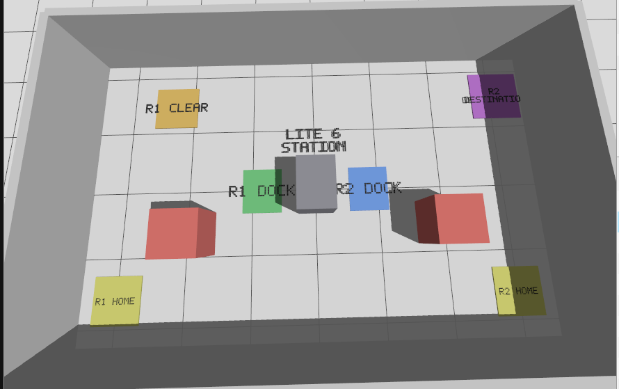

# ET 5900 — Milestone 2: Multi-Robot FSM Student Package

**ROS 2 Jazzy + Gazebo Harmonic · Ubuntu 24.04**

This project provides the simulation for two TurtleBot 4 Lite robots and one UFactory Lite 6 fixed robot arm at a shared manufacturing workstation. **Each team writes only its own finite-state machine (FSM)** in `student_fsm/teamN_fsm.py`. The instructor provides the robot launchers, ROS action helper, and central coordinator. No retries or recovery FSMs are required.

**Simplified scope:** predefined robot navigation goals and six-joint Lite 6 poses. No gripper, box handling, tray, MoveIt, or RViz is necessary.



## 1. Teams and their assigned FSMs

| Team | Robot | Required sequence | File to edit |
|---|---|---|---|
| 1 — Material transport | `/robot1` TurtleBot 4 Lite | `R1_DOCK → WAIT_FOR_PICK → R1_CLEAR` | `student_fsm/team1_fsm.py` |
| 2 — Workstation | Lite 6 | `WAIT_R1 → HOME → R1_PICK → HOME → WAIT_R2 → R2_PLACE → HOME` | `student_fsm/team2_fsm.py` |
| 3 — Receiving transport | `/robot2` TurtleBot 4 Lite | `WAIT_R1_CLEAR → R2_DOCK → WAIT_PLACE → R2_DESTINATION` | `student_fsm/team3_fsm.py` |

A WAIT state simply checks a shared Boolean completion signal and stays put until it becomes true. Students implement **state transitions, guards, action success checks, and the COMPLETE state**. On action failure, stop and report; no retry or recovery required.

The provided central coordinator (`student_fsm/run_integrated.py`) **actually calls all three student FSMs** in order and passes shared signals between them. It runs in one Python process; no student-written ROS messaging is required. See [How the coordinator works](docs/FSM_CENTRAL_COORDINATION.md) and [FSM assignment](docs/STUDENT_FSM_ASSIGNMENT.md).

## 2. Required workspaces

Install these in order (source as instructed):

1. ROS 2 Jazzy and Gazebo Harmonic, including `ros_gz`, `ros2_control`, Nav2/AMCL, `rclpy`, and `python3-yaml`.
2. TurtleBot 4 Jazzy workspace: `~/turtlebot4_ws` (instructor-provided instructions/source).
3. UFactory Lite 6 Jazzy workspace: `~/lite6_jazzy_ws` — [installation guide](docs/INSTALL_LITE6_JAZZY.md).
4. iRobot Create 3 simulation overlay: `~/milestone2_overlay_ws` — [installation guide](docs/INSTALL_MILESTONE2_OVERLAY.md). Download the tested source archive from this **student repository's Releases** page.
5. This course package: `~/mrs_milestone2_ws/src/mrs_milestone2`.

The workspace overlay contains modified Create 3 simulation sources required for the TurtleBot 4 Gazebo setup. **Do not skip it.** `build/`, `install/`, and `log/` must be generated locally, not copied from the instructor computer.

## 3. Clone and build the course package

```bash
mkdir -p ~/mrs_milestone2_ws/src
cd ~/mrs_milestone2_ws/src
git clone https://github.com/apandastider/ET5900-Milestone02-MRS-Students.git mrs_milestone2

# Keep a map copy where older launcher components may expect it.
mkdir -p ~/mrs_milestone2_ws/maps
cp ~/mrs_milestone2_ws/src/mrs_milestone2/maps/milestone2_map.* ~/mrs_milestone2_ws/maps/

source /opt/ros/jazzy/setup.bash
source ~/turtlebot4_ws/install/setup.bash
source ~/lite6_jazzy_ws/install/setup.bash
source ~/milestone2_overlay_ws/install/setup.bash

cd ~/mrs_milestone2_ws
colcon build --symlink-install --packages-select mrs_milestone2
source install/setup.bash
```

For each new terminal (including a new SSH connection), source the workspaces in the **same order**:

```bash
source /opt/ros/jazzy/setup.bash
source ~/turtlebot4_ws/install/setup.bash
source ~/lite6_jazzy_ws/install/setup.bash
source ~/milestone2_overlay_ws/install/setup.bash
source ~/mrs_milestone2_ws/install/setup.bash
cd ~/mrs_milestone2_ws/src/mrs_milestone2
```

## 4. Run one team's simulation (one clean session at a time)

```bash
# Team 1 (TurtleBot 4, Nav2/AMCL/LiDAR)
bash scripts/milestone2_team.sh team1 start
bash scripts/milestone2_team.sh team1 status

# Team 2: use a FRESH session after stopping Team 1
# bash scripts/milestone2_team.sh team1 stop
# bash scripts/milestone2_team.sh team2 start
# bash scripts/milestone2_team.sh team2 status

# Team 3: use a FRESH session after stopping Team 2
# bash scripts/milestone2_team.sh team2 stop
# bash scripts/milestone2_team.sh team3 start
# bash scripts/milestone2_team.sh team3 status
```
To remove Charging Dock:

```bash
gz service -s /world/milestone2_multi_robot_transfer/remove \
  --reqtype gz.msgs.Entity \
  --reptype gz.msgs.Boolean \
  --timeout 3000 \
  --req 'name: "robot1/standard_dock", type: MODEL'
```
```bash
gz service -s /world/milestone2_multi_robot_transfer/remove \
  --reqtype gz.msgs.Entity \
  --reptype gz.msgs.Boolean \
  --timeout 3000 \
  --req 'name: "robot2/standard_dock", type: MODEL'
```
**Do not run** `milestone2_start_safe.sh` after a team launcher: that starts all three robots. A team's launcher starts only its assigned robot in a fresh world; when an existing integrated world is running, it may reuse processes. `stop` resets the recorded shared Milestone 2 simulation and may affect other running teams.

Under SSH without a DISPLAY, the student `world.launch.py` selects Gazebo's headless (`-s`) mode. If LiDAR fails in headless mode, inspect the Gazebo sensor rendering logs rather than assuming localization works.

## 5. FSM learning and tests (terminal, no GUI)

```bash
# See an actual tiny WAIT-state demonstration (no robots)
python3 student_fsm/run_integrated.py --demo

# Print the planned state order (no robot motion)
python3 student_fsm/run_team.py --team 1 --dry-run
python3 student_fsm/run_team.py --team 2 --dry-run
python3 student_fsm/run_team.py --team 3 --dry-run

# AFTER implementing your own team FSM, test logic with fake successful actions
python3 student_fsm/run_team.py --team 1 --simulate

# AFTER launching your own team robot, run real motion
python3 student_fsm/run_team.py --team 1
```

Team 2 uses `--team 2`, Team 3 uses `--team 3`. `--simulate` **does not** prove real robot motion; it checks code logic only. The unfinished templates intentionally fail in simulation until students implement their TODOs.

## 6. Central coordinator (instructor-provided, read-only for students)

```bash
# First, read the flow and WAIT example (works before writing the FSMs)
python3 student_fsm/run_integrated.py --demo
python3 student_fsm/run_integrated.py --dry-run

# AFTER all three FSMs are complete: run full logic with fake robot actions
python3 student_fsm/run_integrated.py --simulate

# Instructor only: with ALL THREE robots started and checked, run actual actions
# bash scripts/milestone2_start_safe.sh start
# python3 student_fsm/run_integrated.py
```

The coordinator calls `step(api, signals)` on each team's FSM in round-robin order. A completed action sets its signal only **after success**. A team that is waiting returns `False` and is revisited on the next round. This is a simplified single-process teaching model, not a distributed fleet control protocol.

## 7. AMCL/Nav2 localization checks (Teams 1 and 3)

A previously observed failure was Nav2 `START_OUTSIDE_MAP` (error 203), caused by an incorrect AMCL estimate. The revised team launcher requests AMCL initialization at the configured HOME pose on fresh spawn and checks the estimated position against map bounds. **This fix still requires a fresh-start validation on the workstation; a successful old session is not proof.**

```bash
# Run only when the team robot has started
python3 scripts/milestone2_team_pose_check.py \
  --robot robot1 \
  --map maps/milestone2_map.yaml \
  --config config/milestone2_locations_and_poses.yaml

ros2 lifecycle get /robot1/bt_navigator
timeout 8 ros2 topic echo /robot1/amcl_pose --once --field pose.pose.position
```

For Team 3, replace `robot1` with `robot2`. If the estimated position is outside the map or does not match Gazebo, **do not run navigation**. Check scans and TF, then run the supplied team AMCL initializer using the installed team launch guide; do not modify map origin as a first response.

## 8. Expected interface names

- Robot 1 Nav2: `/robot1/navigate_to_pose`.
- Robot 2 Nav2: `/robot2/navigate_to_pose`.
- Lite 6 trajectory: typically `/lite6_traj_controller/follow_joint_trajectory` (confirm using `ros2 action list -t`).
- Robot odometry: `/robot1/odom` or `/robot2/odom`.
- LiDAR: `/robot1/scan` or `/robot2/scan`.

Students should **only edit** their own `student_fsm/teamN_fsm.py`. The motion helper (`student_fsm/robot_api.py`), central coordinator, world, YAML poses, and launcher are provided. The instructor validates integration.

## 9. Submission and known limitations

Submit your `teamN_fsm.py`, terminal test log, and a concise explanation of states, WAIT conditions and action success checking. No recovery, retries, gripper, box-transfer simulation, RViz, or MoveIt required.

Do not claim a successful integrated robot test based solely on `--simulate` or `--demo`. Fresh-start launcher/AMCL behavior, headless sensor rendering, and live student action-client behavior must be verified on the teaching workstation before distribution.

### Additional reading

- [FSM assignment and rubric](docs/STUDENT_FSM_ASSIGNMENT.md)
- [Central coordination explanation](docs/FSM_CENTRAL_COORDINATION.md)
- [Lite 6 installation guide](docs/INSTALL_LITE6_JAZZY.md)
- [Create 3 overlay installation guide](docs/INSTALL_MILESTONE2_OVERLAY.md)
